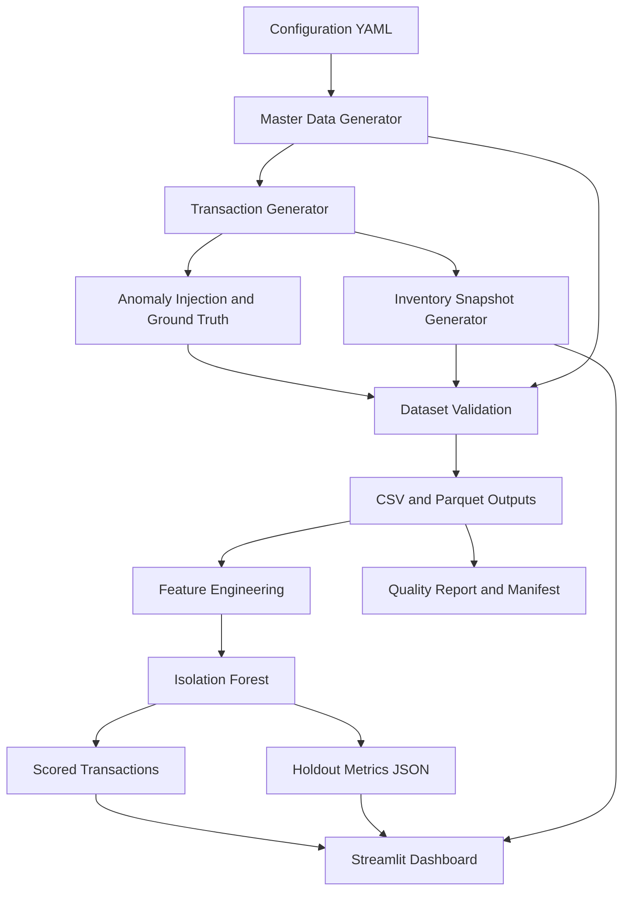

# Retail Inventory Anomaly Detection
## Synthetic Data, Unsupervised Machine Learning, and Interactive Investigation Dashboard

**Project type:** Proof of Concept (POC)  
**Implementation:** Python, pandas, NumPy, scikit-learn, Streamlit, Plotly  
**Primary objective:** Demonstrate an end-to-end approach for generating retail inventory data, detecting potentially unusual transactions, evaluating detection quality, and presenting results through an interactive dashboard.

---

## 1. Executive summary

Retailers process large volumes of inventory movements across stores, products, and warehouses. Unusual movements can be difficult to identify through manual review or fixed rules alone. Examples include unusually large stock movements, unexplained adjustments, duplicate-feed events, and differences between expected and observed stock.

This POC demonstrates a data and machine-learning workflow for exploring that problem. It generates synthetic retail master data and inventory transactions, injects known anomaly labels for evaluation, derives transaction features, trains an Isolation Forest model, scores transactions, measures performance against the injected labels, and presents results in a dashboard.

The solution is intentionally built as a standalone Python project. It does not depend on OpenSpec or an external enterprise data platform.

### What the POC demonstrates

- Repeatable generation of linked synthetic retail datasets.
- Data-quality and referential-integrity validation.
- Separate ground-truth labels for evaluating a detection model.
- Prior-history feature engineering for transaction-level anomaly detection.
- Chronological train/test evaluation of an unsupervised Isolation Forest model.
- CSV and Parquet outputs for downstream analysis.
- A Streamlit dashboard concept for monitoring results and investigating transactions.

### What the POC does not yet prove

This is an experimental baseline using synthetic data. Its labels are generated by code, and some injected scenarios are not yet fully realistic. The current metrics must not be interpreted as evidence of production fraud detection, financial-loss prevention, or real-world anomaly-detection effectiveness.

---

## 2. The business problem and presentation story

### The business challenge

Inventory movements occur continuously across stores and warehouses. A retailer needs to identify transactions that deserve investigation without asking an analyst to inspect every event manually.

A useful detection workflow should help answer:

1. What transactions look unusual?
2. Which stores, products, or transaction types are associated with the alerts?
3. How unusual is each transaction relative to historical behavior?
4. How many alerts correspond to known anomalies in a controlled test?
5. How many normal transactions are incorrectly flagged?
6. What evidence should an analyst inspect before taking action?

### The proposed approach

Rather than treating a model prediction as proof of wrongdoing, the POC treats the model as a **decision-support mechanism**. It ranks or flags unusual transactions for human review. Data validation and inventory reconciliation provide additional context.

### Suggested presentation narrative

A clear presentation can follow this sequence:

1. **Problem:** Inventory teams need to identify unusual movements in high-volume transaction data.
2. **Approach:** Build a reproducible synthetic retail environment and inject known scenarios.
3. **Data foundation:** Validate master data, transactions, snapshots, and labels.
4. **Detection:** Engineer features from transactions and prior history, then apply Isolation Forest.
5. **Evaluation:** Compare predictions against the synthetic ground truth using a chronological holdout.
6. **Visibility:** Use a dashboard to summarize alerts, inspect transactions, and view stock variances.
7. **Evidence:** Show the current baseline metrics honestly, including its weaknesses.
8. **Roadmap:** Improve scenario realism, duplicate detection, anomaly-specific evaluation, and alert thresholds before any production consideration.

---

## 3. Scope and synthetic data profile

The default configuration is stored in `config/inventory_config.yaml`.

| Parameter | Default value |
|---|---:|
| Products | 1,000 |
| Stores | 50 |
| Warehouses | 5 |
| Transaction history | 90 days |
| Transactions | 100,000 |
| Target injected anomaly rate | 2% |
| Expected injected anomaly events | Approximately 2,000 |
| Random seed | 42 |
| Output formats | CSV and Parquet |
| Starting date | 2026-01-01 |

The exact generated counts and realized anomaly rate are recorded by the pipeline. If configuration values change, the README's default figures should not be treated as the actual run results.

### Master datasets

- **Products:** Product identifier, category, unit cost, unit price, supplier identifier, and active status.
- **Stores:** Store identifier, region, store type, floor area, and assigned warehouse.
- **Warehouses:** Warehouse identifier, region, and capacity units.

The current synthetic product categories include Apparel, Footwear, Accessories, Home, Beauty, and Electronics. Regions include North, South, East, West, and Central.

### Transaction dataset

The transaction table includes identifiers, timestamp, store, product, warehouse, transaction type, signed quantity, unit cost, source system, and synthetic anomaly labels.

The signed quantity convention is:

| Transaction type | Quantity convention |
|---|---|
| `RECEIPT` | Positive |
| `RETURN` | Positive |
| `TRANSFER_IN` | Positive |
| `SALE` | Negative |
| `TRANSFER_OUT` | Negative |
| `ADJUSTMENT` | Positive or negative |

These conventions simplify the representation of inventory movements. They are not a complete implementation of a retailer's inventory accounting rules.

### Inventory snapshots

The snapshot generator derives daily records for a sampled universe of store/product combinations. It records opening quantity, net movement, calculated closing quantity, expected closing quantity, observed closing quantity, variance, and an anomaly flag.

The current snapshot implementation is a POC scaffold. It initializes synthetic opening balances and replays signed movements for sampled store/product pairs. Counting-error events can introduce observed-versus-expected differences. It should not yet be described as a fully reconciled inventory ledger or a complete physical-count simulation.

### Ground-truth labels

The transaction generator injects labels for four scenario categories:

- `UNEXPLAINED_SHRINKAGE`
- `UNUSUAL_VELOCITY`
- `DUPLICATE_TRANSACTION`
- `COUNTING_ERROR`

`anomaly_ground_truth` stores the known injected anomaly events separately. Transaction outputs also retain label columns for simulation quality checks and evaluation.

Ground-truth labels are **evaluation targets only**. They must not be supplied as model features.

---

## 4. High-level architecture



### Main processing stages

1. **Configuration:** Loads generation settings, categories, regions, output formats, and random seed.
2. **Master-data generation:** Creates products, stores, and warehouses with repeatable identifiers and relationships.
3. **Transaction generation:** Creates dated inventory movements and injects selected anomaly labels.
4. **Snapshot derivation:** Builds daily stock records for selected store/product pairs.
5. **Validation:** Checks required columns, identifiers, relationships, quantity conventions, labels, and snapshot consistency.
6. **Feature engineering:** Converts transaction and prior-history information into numeric model inputs.
7. **Model training and scoring:** Fits Isolation Forest on earlier transactions and evaluates on later transactions.
8. **Output publication:** Writes generated tables, scored transactions, model metrics, and a manifest.
9. **Dashboard:** Reads generated output files for visual monitoring and investigation.

The dashboard is designed as a separate presentation layer. It reads pipeline outputs rather than regenerating data or retraining the model every time a user opens the dashboard.

---

## 5. Technology stack

| Component | Technology | Purpose |
|---|---|---|
| Language | Python 3.11+ | Project implementation |
| Data processing | pandas, NumPy | Synthetic generation, transformation, aggregation |
| Configuration | PyYAML | YAML configuration loading |
| Storage formats | CSV, Parquet via PyArrow | Interoperable output datasets |
| Machine learning | scikit-learn | Isolation Forest and evaluation metrics |
| Testing | pytest | Automated behavior checks |
| Dashboard | Streamlit | Interactive web interface |
| Visualizations | Plotly | Interactive charts |

The project uses a `src`-based Python package layout. Editable installation (`pip install -e .`) is supported by the `pyproject.toml` build configuration.

---

## 6. Project structure

```text
retail-inventory-anomaly/
├── config/
│   └── inventory_config.yaml
├── data/
│   ├── raw/
│   ├── processed/
│   └── output/
├── src/
│   └── inventory_anomaly/
│       ├── __init__.py
│       ├── config.py
│       ├── generators.py
│       ├── validation.py
│       ├── feature_engineering.py
│       ├── anomaly_model.py
│       └── pipeline.py
├── tests/
│   ├── test_config.py
│   ├── test_generation.py
│   └── test_anomaly_model.py
├── requirements.txt
├── pyproject.toml
└── README.md
```

`dashboard.py` is provided as an additional dashboard file. Copy it to `src/inventory_anomaly/dashboard.py` in the project before launching the dashboard. Add Streamlit and Plotly to `requirements.txt` as described in the dashboard setup section below.

---

## 7. Data validation and reproducibility

The pipeline validates the generated datasets before publishing outputs. Checks include required columns, uniqueness of key identifiers, non-null required fields, valid transaction types and signed-quantity conventions, referential integrity between transactions and master data, ground-truth consistency, and snapshot variance consistency.

The project uses a fixed random seed (`42`) in its default configuration so that generated data and model behavior can be reproduced under the same software versions and configuration.

The pipeline writes a `manifest.json` file containing information such as project name, schema version, seed, configuration, table-quality summaries, validation status, and realized anomaly rate.

A successful validation run means the checks implemented in this POC passed. It does not guarantee that every synthetic event reflects realistic retail operations.

---

## 8. Feature engineering

The current feature engineering creates numeric features from transaction fields and prior history. It deliberately excludes ground-truth label fields and the synthetic `DUPLICATE_FEED` source-system marker.

Current feature groups include:

- **Transaction magnitude:** Log-transformed absolute quantity.
- **Transaction direction:** Sign of the quantity.
- **Unit cost:** Log-transformed unit cost.
- **Temporal context:** Transaction hour, day of week, and weekend indicator.
- **Historical behavior:** Prior transaction count for a store/product pair, prior mean absolute quantity, prior standard deviation, and current quantity relative to the prior mean.
- **Transaction type:** One-hot encoded transaction types.

Historical statistics are computed using earlier records for the store/product pair; the current transaction is excluded from its own prior-history mean and standard deviation.

### Leakage prevention

The model feature matrix must not include:

- `is_anomaly`
- `anomaly_type`
- `severity`
- `event_id` or `transaction_id` as predictive identifiers
- Other fields that directly encode the injected label rather than operational behavior

`source_system` is excluded because the current synthetic duplicate scenario uses `DUPLICATE_FEED` as an artificial marker. Feeding that marker to the model would leak the scenario label into the feature set.

### Feature-engineering limitation

The current duplicate scenario changes the source-system marker but does not create a genuinely repeated transaction with matching transaction characteristics. Since the marker is excluded, the current model has no reliable duplicate-specific signal. This must be corrected in the generator and feature design before duplicate detection can be assessed meaningfully.

---

## 9. Machine-learning approach: Isolation Forest

Isolation Forest is an unsupervised anomaly-detection algorithm. It identifies records that are easier to isolate from the broader dataset using randomized tree partitions. The model does not train on the synthetic anomaly labels.

### Current model setup

| Setting | Current value |
|---|---|
| Algorithm | Isolation Forest |
| Number of estimators | 200 |
| Random seed | Project seed (42 by default) |
| Training/test strategy | Chronological 80/20 split |
| Model input | Engineered numeric features |
| Ground truth in training features | Excluded |
| Evaluation | Final 20% of chronologically ordered transactions |

The pipeline sorts transactions by timestamp (and transaction identifier when available), uses the first 80% for fitting, and evaluates predictions on the final 20%. The model also produces anomaly scores and predictions for all transactions for investigation.

### Output interpretation

- **Anomaly score:** Higher values indicate that the model considers the transaction more anomalous relative to the fitted model.
- **Predicted anomaly:** The model's binary prediction based on its fitted decision threshold.
- **Evaluation split:** Indicates whether a transaction belongs to the training or holdout portion.

Training-set predictions are useful for exploratory analysis but are not an independent estimate of generalization performance. Holdout metrics are the relevant baseline.

---

## 10. Baseline model results

The currently captured `model_metrics.json` reports the following chronological holdout evaluation. These values describe the recorded run and should be recalculated after any changes to the generator, features, configuration, dependencies, or model.

| Metric | Recorded result |
|---|---:|
| Training rows | 80,000 |
| Holdout rows | 20,000 |
| Number of features | 16 |
| Injected anomaly rate in holdout | 2.175% |
| Predicted anomaly rate in holdout | 6.105% |
| Precision | 18.67% |
| Recall | 52.41% |
| F1-score | 27.54% |
| False-positive rate | 5.08% |

### Holdout confusion matrix

| | Predicted normal | Predicted anomaly |
|---|---:|---:|
| Actual normal | 18,572 (true negative) | 993 (false positive) |
| Actual anomaly | 207 (false negative) | 228 (true positive) |

### Business interpretation

- **Precision of 18.67%:** About 19 of every 100 predicted anomalies match the synthetic ground-truth labels in this holdout run.
- **Recall of 52.41%:** The model detected 228 of the 435 injected anomaly events in the holdout set.
- **False-positive rate of 5.08%:** Approximately 5% of ground-truth normal transactions were incorrectly flagged.
- **Predicted anomaly rate of 6.105%:** The model flagged a larger share of holdout transactions than the injected anomaly rate.

These results show a functioning baseline, not a production-ready detector. The false-positive burden is high, and overall metrics do not tell us which anomaly categories are detected well. The next evaluation should report precision and recall by anomaly type and inspect the scenarios the model misses.

### Important qualification

The synthetic labels are simplified and are not independent evidence of real inventory loss, fraud, or operational error. A model can only detect patterns represented in its input data. If the generator marks an event as anomalous without creating a detectable behavioral difference, a low score may reflect the limitations of the synthetic scenario rather than a defect in the algorithm alone.

---

## 11. Dashboard design

The dashboard is intended to turn pipeline outputs into an analyst-facing view. It is implemented as a separate Streamlit application using Plotly charts.

### Dashboard sections

1. **Executive overview**
   - Transactions scored
   - Predicted anomalies and predicted anomaly rate
   - Inventory snapshot count
   - Holdout precision, recall, F1-score, and false-positive rate

2. **Anomaly analytics**
   - Predicted anomalies by transaction type
   - Distribution of anomaly scores
   - Trend of predicted anomalies by date

3. **Transaction investigation**
   - Filters for store, transaction type, date range, and prediction status
   - Transaction-level identifiers, quantities, source system, anomaly score, and prediction
   - Download of filtered transaction results as CSV

4. **Inventory reconciliation**
   - Number of snapshots with non-zero variance
   - Absolute variance units
   - Largest observed-versus-expected snapshot variances

5. **Technical details**
   - Project and schema metadata from the manifest
   - Validation status
   - Model feature list and confusion matrix

### Dashboard data sources

The dashboard reads these generated artifacts when available:

- `scored_transactions.csv` or `scored_transactions.parquet`
- `inventory_snapshots.csv` or `inventory_snapshots.parquet`
- `model_metrics.json`
- `manifest.json`

It can also read the product and store master tables. If the expected scored transaction file or metrics are missing, run the pipeline first and check the output directory.

### Dashboard setup

Install the additional dependencies:

```powershell
.\.venv\Scripts\python.exe -m pip install streamlit plotly
```

Add these dependencies to `requirements.txt` so that future installations include them:

```text
streamlit>=1.40
plotly>=5.24
```

Copy the provided `dashboard.py` to:

```text
src/inventory_anomaly/dashboard.py
```

Start the dashboard from the project root:

```powershell
.\.venv\Scripts\python.exe -m streamlit run src\inventory_anomaly\dashboard.py
```

Streamlit normally displays a local URL, commonly `http://localhost:8501`. Open that URL in a browser.

---

## 12. Setup and execution on Windows

### Prerequisites

- Python 3.11 or later. Python 3.13 is the environment used for the current development workflow.
- Windows PowerShell.
- The project source code and configuration file.

### Create and activate the virtual environment

From the project root:

```powershell
py -3.13 -m venv .venv
.\.venv\Scripts\Activate.ps1
python --version
python -m pip install --upgrade pip
```

If PowerShell does not permit activation, use the environment's Python executable directly in the commands below.

### Install dependencies and the project

```powershell
.\.venv\Scripts\python.exe -m pip install -r requirements.txt
.\.venv\Scripts\python.exe -m pip install -e .
```

The editable install is supported by the `pyproject.toml` configuration. Run these commands from the directory containing `pyproject.toml`.

### Run automated tests

```powershell
.\.venv\Scripts\python.exe -m pytest -v
```

The current test suite contains six tests covering configuration loading and validation, generation relationships and labels, seed reproducibility, feature leakage checks, and model scoring/holdout metrics.

The recorded development run reported **6 passed**. Always run the tests in the environment you intend to demonstrate.

### Run the end-to-end pipeline

```powershell
.\.venv\Scripts\python.exe -m inventory_anomaly.pipeline --config config/inventory_config.yaml --output data/output
```

The pipeline loads configuration, generates data, validates datasets, runs feature engineering and Isolation Forest, and writes outputs and metadata. If validation fails, it raises an error rather than publishing a successful validation status.

### Start the dashboard

```powershell
.\.venv\Scripts\python.exe -m streamlit run src\inventory_anomaly\dashboard.py
```

Run the pipeline before starting the dashboard so that the required scored output and metrics exist.

---

## 13. Output artifacts

The default output directory is `data/output/`.

| Artifact | Description |
|---|---|
| `products.csv` / `.parquet` | Product master data |
| `stores.csv` / `.parquet` | Store master data and warehouse assignment |
| `warehouses.csv` / `.parquet` | Warehouse master data |
| `inventory_transactions.csv` / `.parquet` | Generated transaction events |
| `inventory_snapshots.csv` / `.parquet` | Daily stock snapshot records |
| `anomaly_ground_truth.csv` / `.parquet` | Injected anomaly events used for evaluation |
| `scored_transactions.csv` / `.parquet` | Transaction records enriched with model scores and predictions |
| `model_metrics.json` | Holdout metrics, confusion matrix, feature list, and split information |
| `manifest.json` | Configuration, dataset-quality summaries, seed, and validation status |

The configured output formats are CSV and Parquet. If a particular artifact is missing, inspect the pipeline execution log and the output directory rather than assuming that the file was generated.

---

## 14. Testing strategy

Automated tests are intended to check the core behaviors of the POC.

- **Configuration tests:** Confirm default configuration loading and rejection of invalid anomaly rates.
- **Generation tests:** Check expected record counts, transaction identifier uniqueness, valid product references, ground-truth counts, dataset validation, and deterministic output behavior.
- **Model tests:** Check that ground-truth labels and direct label-leakage fields are excluded from features and that the model returns anomaly scores and holdout metrics.

Passing tests indicates that the tested code paths work under the test conditions. It does not validate the realism of every synthetic anomaly scenario or guarantee the quality of a production model.

---

## 15. Current limitations and risks

The following limitations should be disclosed in a technical review or presentation.

### Synthetic scenario realism

The data is generated for experimentation. Real retail data has seasonality, promotions, stock policies, supplier lead times, returns, shrinkage patterns, inventory reservations, and other operational constraints that are not fully represented here.

### Duplicate transaction scenario

The current duplicate anomaly injection uses an artificial `DUPLICATE_FEED` source-system marker rather than creating a true duplicate transaction. The marker is intentionally excluded from model features. As a result, the current dataset does not adequately test realistic duplicate detection.

### Inventory accounting fidelity

The snapshot generator samples store/product combinations and derives expected and observed balances from simplified logic. Paired transfers, realistic stock constraints, and full ledger reconciliation need further implementation before the snapshots can be treated as an accounting-grade simulation.

### Anomaly labels and feature observability

Injected labels are not automatically equivalent to detectable anomalies. Each scenario should produce realistic observable signals, and those signals should be available to the model without exposing the label itself.

### Model performance

The current precision is low and false-positive burden is material. Threshold tuning may change the alert volume, but it cannot compensate for missing or unrealistic features. Improvements should first address scenario generation and feature engineering, then compare thresholds using a validation set.

### Production readiness

This POC does not include production data connectors, role-based access, model monitoring, alert routing, human-review workflows, model registry, deployment automation, or a validated security architecture. These would need separate design and implementation.

---

## 16. Recommended next steps

Prioritize improvements in this order:

1. **Per-anomaly-type evaluation:** Calculate precision, recall, and F1-score for shrinkage, unusual velocity, duplicate transactions, and counting errors.
2. **Realistic duplicate generation:** Create genuine duplicate-like transaction records and develop behavior-based duplicate candidate features.
3. **Scenario-specific feature engineering:** Add features for transaction velocity, quantity deviation, duplicate similarity, and inventory variance where the data supports them.
4. **Improve snapshot simulation:** Model transfer legs and stock movements consistently, define behavior when balances would become negative, and document reconciliation rules.
5. **Threshold selection:** Use a separate validation set to choose a useful alert-volume/recall trade-off; reserve the final chronological holdout for final comparison.
6. **Dashboard improvements:** Add anomaly-type drill-down once reliable scenario labels and per-type metrics are available.
7. **Real-data validation:** Before any operational claim, test against appropriately governed, representative historical data with independently reviewed outcomes.

---

## 17. Suggested PowerPoint outline

This README can serve as the source for an 8–10 slide presentation.

| Slide | Title | Key message |
|---|---|---|
| 1 | Retail Inventory Anomaly Detection | What the POC demonstrates |
| 2 | Business Problem | Why high-volume inventory movements need prioritization |
| 3 | Proposed Approach | Synthetic data, feature engineering, Isolation Forest, and dashboard |
| 4 | Data Foundation | Master data, transactions, snapshots, ground truth, and validation |
| 5 | Solution Architecture | End-to-end pipeline and artifact flow |
| 6 | Machine-Learning Approach | Unsupervised detection, prior-history features, chronological evaluation |
| 7 | Baseline Results | Precision, recall, F1-score, false positives, and confusion matrix |
| 8 | Dashboard Walkthrough | Overview, alert investigation, anomaly trends, and stock variance |
| 9 | Limitations and Lessons Learned | Synthetic realism, duplicate detection, reconciliation, and false alerts |
| 10 | Roadmap | Scenario improvements, better features, threshold selection, and real-data validation |

### Suggested closing message

> This POC establishes an end-to-end foundation for retail inventory anomaly analysis: reproducible data generation, data-quality checks, unsupervised scoring, holdout evaluation, and interactive investigation. The current results provide a measurable baseline and expose the next engineering priorities. The next phase is to make anomaly scenarios more realistic, improve detection quality, and validate the approach against representative real-world outcomes.

---

## 18. Conclusion

The project establishes a practical foundation for experimenting with inventory anomaly detection. Its value at this stage is the complete, testable workflow and the evidence it generates—not a claim that the current model is ready for operational use.

The next milestone is to improve anomaly scenario realism and per-type evaluation, then use the dashboard to compare the resulting model iterations transparently.
